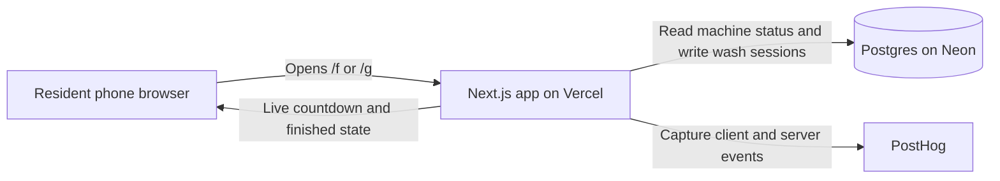

# Architecture

One diagram, one line of why per layer. The question each line answers is not "is this the best technology" but "can this team deploy it at a public URL by the Week 7 lab."

## The diagram

## The stack, one line per layer

| Layer | Choice | Why we can deploy it by Week 7 |
|---|---|---|
| Hosting | Vercel | Free tier; automated HTTPS and public URL in under five minutes |
| App framework | Next.js (App Router) | React-based; deployed via Vercel |
| Database | Postgres on Neon | Hosted serverless Postgres with an instant free tier; two tables needed |
| Analytics | PostHog | Fixed for the course; captures client and server events |
| Messages out | None in Sprint 1 | Messenger bots require verification; countdown is on-screen |
| Sign-in | None | Device UUID in localStorage identifies unique residents without login friction |

## Sprint 1 scope

All 8 machines (4 in Block F, 4 in Block G) are publicly accessible to anyone with the link.

- No accounts or passwords in Sprint 1.
- Each phone generates a persistent anonymous UUID in localStorage.
- No Messenger bots.
- No IoT hardware sensors.
- Countdown and finished state are displayed on-screen.

## Layers we deliberately do not have in Sprint 1

- User login/passwords.
- Messenger bots.
- IoT hardware sensors.

## Secrets and data

**Secrets live in:** `.env.local` (`DATABASE_URL`, `NEXT_PUBLIC_POSTHOG_KEY`). `.gitignore` lists `.env*`.

**Personal data we store:** Zero personal data. No student names, phone numbers, or Messenger handles. Only anonymous device IDs and timestamps.

## Biggest deployment risk

The one thing in this design most likely to break on deploy day is a timezone mismatch between UTC timestamps and the student phone's local time (Tbilisi, UTC+4).

**Mitigation:** Store timestamps in UTC in PostgreSQL and convert them to `Asia/Tbilisi` when displaying dates and times to residents. Use consistent server-side time calculations for countdowns.
